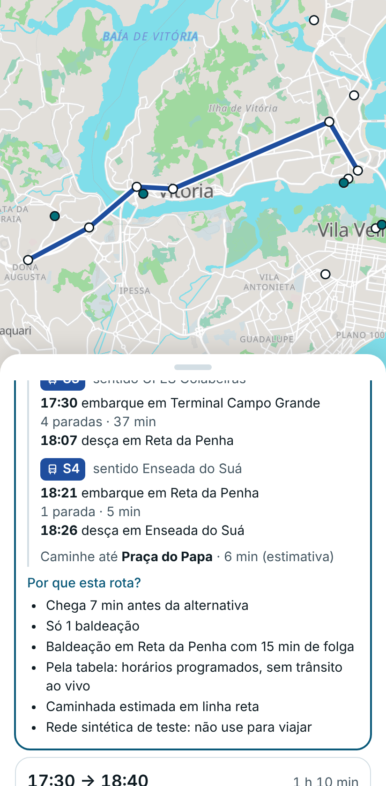
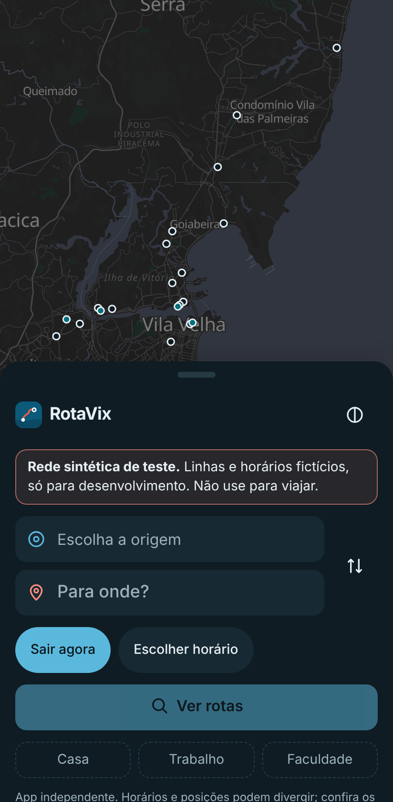
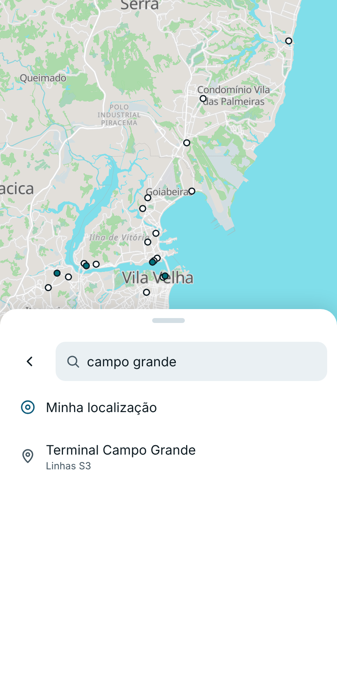
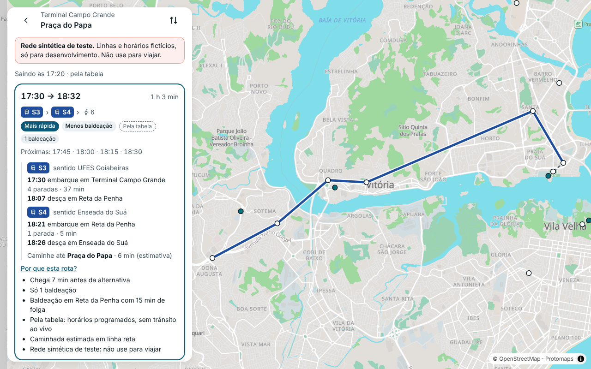

# Demo da Fase 0: Fundação

**Critério de aceite (SPEC §11):** em modo avião, abrir o app, buscar um ponto e planejar uma rota no GTFS sintético.
Esse roteiro roda automaticamente em `e2e/aceite.spec.ts`, no celular (Pixel 7) e no desktop. Abaixo, o mesmo roteiro para você fazer à mão no Poco.

> A rede desta fase é **sintética e fictícia** (linhas S1–S6 e SA1). O app mostra esse aviso o tempo todo.

| Celular (claro)                         | Celular (escuro)                           | Busca                                   |
| --------------------------------------- | ------------------------------------------ | --------------------------------------- |
|  |  |  |



## 1. Preparar o Mac (uma vez)

```bash
cd rotavix
./scripts/doctor.sh            # lista o que falta e o comando para instalar
pnpm install
uv sync --all-packages
pnpm data                      # gera a rede sintética e baixa o mapa (~5 MB) e as fontes
```

## 2. PWA no Poco X7 Pro (via adb, sem emulador)

O service worker só funciona em `https` ou `localhost`. Com `adb reverse`, o Chrome do celular acessa o Mac como `localhost`:

```bash
pnpm build && pnpm --filter @rotavix/app preview     # serve em :4173
adb reverse tcp:4173 tcp:4173                         # com o Poco no cabo e a Depuração USB ligada
```

1. No Chrome do Poco, abra `http://localhost:4173`.
2. Espere sumir o texto "Baixando mapa básico…" no topo (cerca de 5 MB).
3. Menu ⋮ → **Instalar app**. Abra o RotaVix pela tela inicial uma vez.
4. Ligue o **modo avião** e siga o roteiro da seção 4.

## 3. APK de debug no Poco

```bash
export ANDROID_HOME=~/Library/Android/sdk     # macOS
pnpm android:apk                              # build web + cap sync + gradlew assembleDebug
pnpm android:instalar                         # adb install + abre o app
```

No APK, os pacotes vão dentro do app, então ele funciona **em modo avião desde a primeira abertura**.
No HyperOS, a instalação pode pedir confirmação na tela do celular (Opções do desenvolvedor → **Instalar via USB**).
Para inspecionar o WebView, abra `chrome://inspect` no Chrome do Mac.

## 4. Roteiro (em modo avião)

| #   | Ação                                                                                       | Resultado esperado                                                                              |
| --- | ------------------------------------------------------------------------------------------ | ----------------------------------------------------------------------------------------------- |
| 1   | Abrir o app                                                                                | Mapa com ruas (OpenStreetMap), pontos da rede sintética e o selo **Offline** no topo do painel  |
| 2   | **Escolher horário** → um dia útil, 07:00                                                  | Botão vira "Sair às …"                                                                          |
| 3   | **Escolha a origem** → digite `jacaraipe` (sem acento)                                     | Aparece "Jacaraípe · Linhas S5"                                                                 |
| 4   | **Para onde?** → `ufes`                                                                    | Abre a tela de rotas                                                                            |
| 5   | Ver o primeiro cartão                                                                      | **07:00 → 08:12**, S5 › S4, selos "Mais rápida" e "1 baldeação", "Próximas: …"                  |
| 6   | Tocar no cartão                                                                            | Passo a passo (embarque, paradas, desembarque) e a rota desenhada no mapa                       |
| 7   | **Por que esta rota?**                                                                     | "Baldeação apertada em Terminal Laranjeiras: 3 min de folga", "Pela tabela…", "Rede sintética…" |
| 8   | Origem `T. Campo Grande` (testa o sinônimo T. = Terminal) → destino `Praça do Papa`, 17:20 | Duas opções: "Mais rápida" (com 6 min a pé) e "Menos caminhada" (2 baldeações)                  |
| 9   | Origem `Porto de Santana` → destino `Estação Aquaviária Praça do Papa`                     | Ícone de barca e o motivo "Aquaviário …"                                                        |
| 10  | Botão de tema (topo)                                                                       | Alterna automático → claro → escuro                                                             |
| 11  | Arrastar a alça do painel                                                                  | Encaixa em 3 alturas; no tablet/desktop vira painel lateral                                     |
| 12  | Horário 23:50                                                                              | "Nenhuma opção na próxima hora…"                                                                |

## 5. Desempenho

- `pnpm e2e` imprime, com **CPU 4x mais lenta** e rede 3G rápida: primeira tela ~1,3 s, dados prontos ~2,2 s e cálculo da rota ~15 ms (meta: < 700 ms).
- Shell inicial: **107 KB gzip** (meta: < 170 KB; `pnpm --filter @rotavix/app orcamento`). O MapLibre (304 KB gzip) carrega depois, sob demanda.
- No Poco: `chrome://inspect` → Performance → CPU 4x slowdown, para comparar com o aparelho de entrada.
- Na rede sintética esses números são otimistas; na Fase 1, o mesmo teste roda com a rede real (~400 linhas).

## 6. O que ficou pendente

- **GTFS Validator não rodou neste ambiente**, porque o download de releases do GitHub é bloqueado aqui. Ele roda no CI e localmente com `pnpm gtfs:validar` (Java 17+).
- **CI ainda não executou**: o workflow está em `rotavix/.github/workflows/ci.yml` e passa a rodar quando o projeto estiver no repositório próprio.
- Ícone do APK ainda é o padrão do Capacitor (gerar com `@capacitor/assets` na Fase 4). A PWA já usa o ícone do RotaVix.
- O mapa liga os pontos em linha reta; o traçado real (shapes) entra na Fase 1.
- Viagens do dia anterior que passam da meia-noite ainda não entram na busca.
- `DataStore` com Capacitor Filesystem (Fase 1); hoje o APK usa o OPFS do WebView, que funciona, mas a SPEC pede a abstração nativa.
- Botão "voltar" do Android (`@capacitor/app`), favoritos (Casa/Trabalho) e Central Offline: Fase 1.
- Assinatura Ed25519 dos pacotes: Fase 1 (hoje há só sha256 + troca atômica).
- `appId` provisório (`app.rotavix.dev`), em `apps/app/src/brand.ts`.
- Viagem ativa, alerta de desembarque e a tela de otimização de bateria do HyperOS: Fase 3, com teste no Poco.
